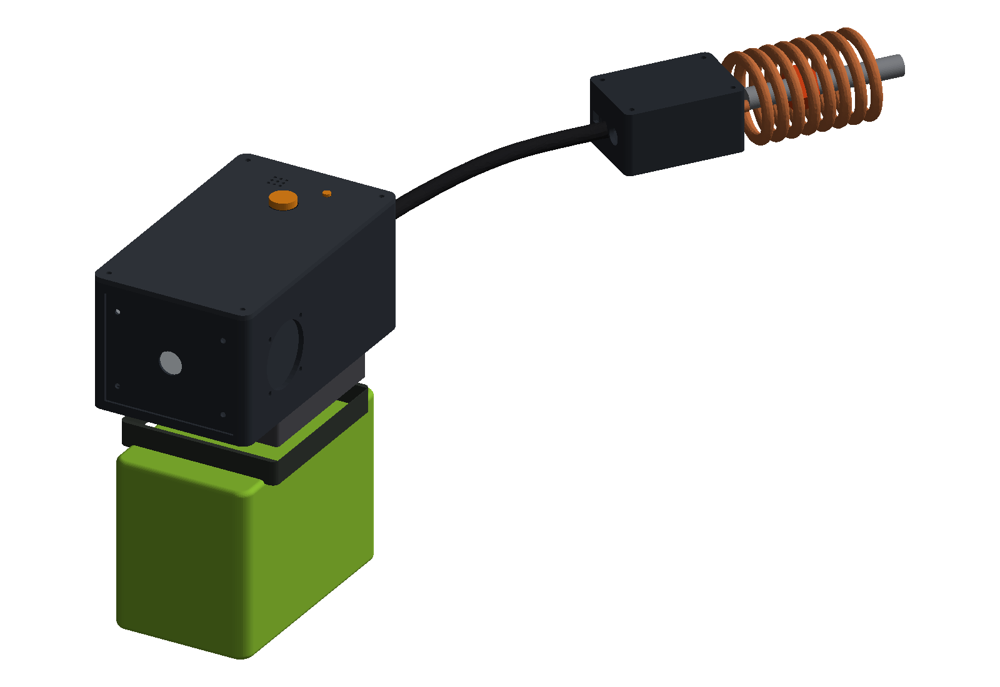
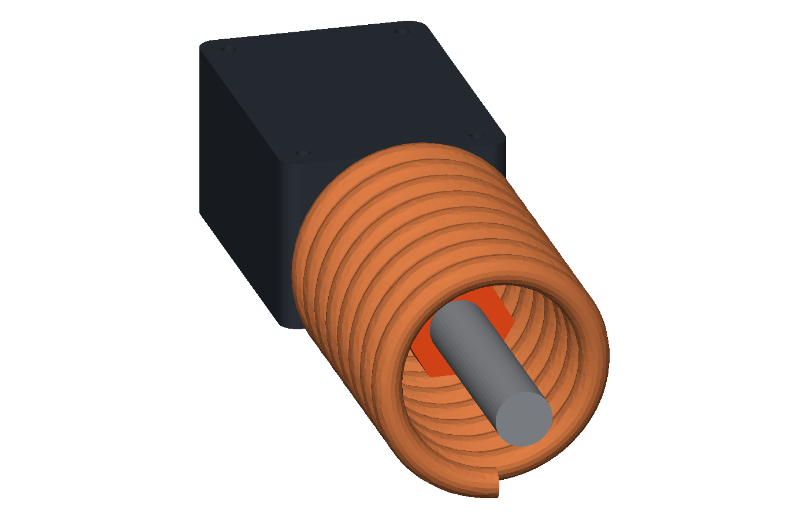
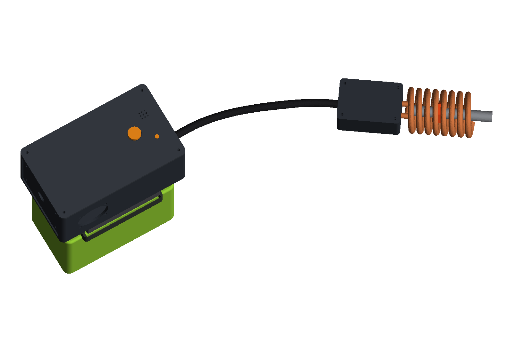
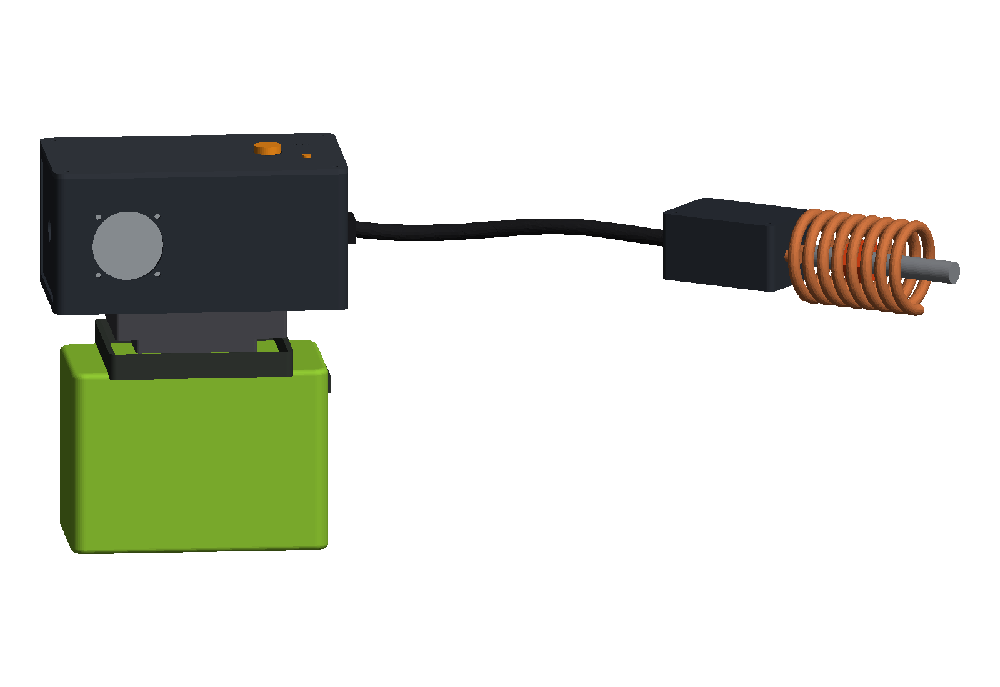
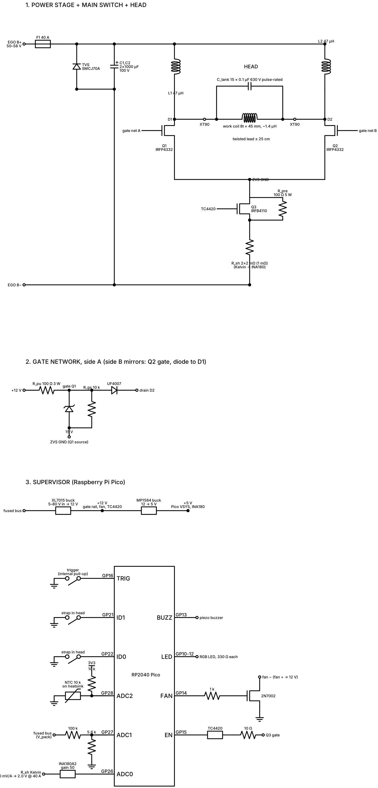

# ego-coil

**A handheld induction bolt heater that runs on an EGO 56 V lawn-tool battery.
About $90 in parts, a weekend to build, and it does what the $500+ commercial
units do: heats a seized nut red-hot in a few seconds with no flame.**



*Mock-up of the assembled unit: body with the EGO pack docked underneath, 25 cm lead, nut-coil head heating a bolt. Rendered from the CAD in this repo (`cad/render_mockup.py`).*

The design is a ZVS (Mazzilli) oscillator — the same simple circuit behind
every cheap induction heater — done properly for 56 V: 250 V MOSFETs, a
custom 2 oz PCB so the gate loops are short, resonant capacitors moved
**into the coil head** so the lead stays thin and flexible, and a Raspberry
Pi Pico that trips before the battery's BMS does. Heads are swappable:
a nut coil, a pencil coil for tight spots, a pancake for flat panels.

> **Status: designed, not yet built.** Everything here comes from first
> principles and has been cross-checked, but no one has heated a bolt with it
> yet. The build guide is written so the first build replaces the estimates
> with measurements *before* the battery goes on. If you build one, open an
> issue with what you measured.

## What you get

| | |
|---|---|
|  |  |
| Head: 8-turn copper coil with the cap bank in the shell behind it; swappable on an XT90 | Trigger and LED on the lid, exhaust slots over the heatsink |
|  |  |
| Fan side; pack hangs below like a drill battery | Schematic (`docs/schematic.svg`) |

```
EGO pack ─┤ BODY: fuse → ZVS stage → burst switch → supervisor ├══ 25 cm lead ══╡ HEAD: coil + caps ╞
```

## Build it

Read these in order; they are written for someone who can solder and has
used a multimeter but has never built an induction heater.

1. **[docs/build-guide.md](docs/build-guide.md)** — the step-by-step build, start to finish
2. **[docs/bom.md](docs/bom.md)** — parts list, ~$86 budget column and a name-brand column
3. **[docs/design.md](docs/design.md)** — why every part is what it is, plus the safety section (read §6 even if you skip the rest)

Then the pieces:

| Folder | What's in it |
|---|---|
| [`pcb/`](pcb/) | Main board: circuit-as-code (`netlist.py`), KiCad netlist, BOM with JLCPCB assembly flags, placement plan |
| [`cad/`](cad/) | Parametric enclosure (CadQuery): body, lid, coil head, and the EGO dock STL. STLs are in `cad/out/` |
| [`firmware/`](firmware/) | MicroPython for the Pico: trigger, power levels, overcurrent / overtemp / timeout trips |
| [`tools/`](tools/) | `zvs_tank.py` coil-and-capacitor calculator — run it for every new head |
| [`docs/`](docs/) | Design, BOM, build guide, dock fitting, schematic |

## Quick numbers

| | |
|---|---|
| Battery | EGO 56 V, 5 Ah or larger (2.5 Ah packs trip their BMS) |
| Power | 1–3 kW into the work, limited to ~2 kW by the 38 A current trip |
| Frequency | ~110–130 kHz with the reference 8-turn coil |
| Duty | 20 s bursts, cooldown enforced by firmware |
| Parts cost | ~$86 (scrap CPU cooler, printed dock), ~$100 all new |
| Tools you need | soldering iron, 3D printer, oscilloscope (a used $40 one is fine), bench supply for bring-up |

## Safety, in one paragraph

This is a 2 kW RF magnetic field on the end of a lithium battery. Keep
people with pacemakers or implants well away. Rings and watches off. Nothing
near fuel lines, brake lines or gas tanks. The work and the coil get hot
enough to burn through gloves. The 40 A fuse at the battery is not optional,
and the head carries 200 V at 100 kHz, so no exposed metal except the coil.
`docs/design.md` §6 has the full list.

## Contributing

Measured numbers beat calculated ones. If you build one, the things worth
reporting back are: measured coil inductance, the frequency with a bolt in
the coil, pack current at full duty, and how hot the caps get after a 20 s
run. Open an issue or a PR.

## Licence

Hardware (docs, CAD, PCB): [CERN-OHL-P v2](LICENSE). Firmware and tools: MIT
(see `LICENSE`). The EGO dock STL (`cad/ego56v_dock.stl`) was contributed
separately and keeps whatever licence it came with; replace it with the
parametric fallback in `cad/build_cad.py` if that matters to you.
