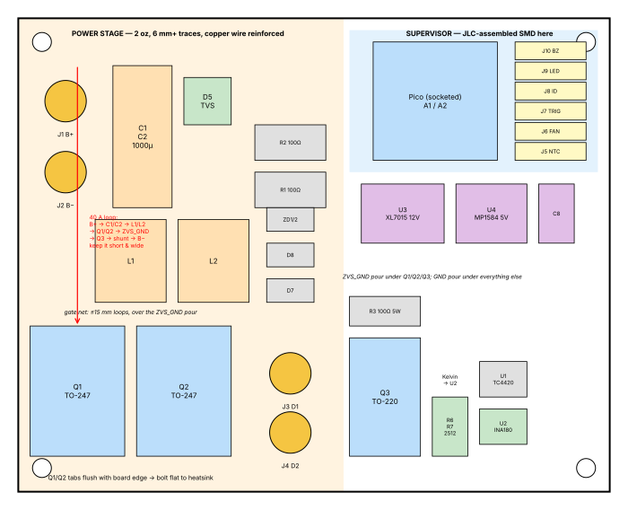

# pcb/ — the main board

One 2-layer, 2 oz board, 100 × 80 mm, carrying the whole body electronics:
ZVS power stage, main switch and shunt, supplies, and a socketed Pico. The
head's cap bank is **not** on this board (it lives in the head, see
`docs/design.md`).

| File | What |
|---|---|
| `netlist.py` | The circuit as code (SKiDL). Run it to regenerate the netlist and BOM. |
| `ego-coil.net` | KiCad netlist, ready to import. |
| `bom.csv` | Every part with footprint, an `Assembly` column (SMT = JLCPCB places it, THT = you solder it), and an empty `LCSC` column to fill at order time. |
| `placement.svg` | Placement plan to scale, with the current-loop rules. |

## Workflow

1. `pip install skidl && python pcb/netlist.py` (only if you change the circuit).
2. KiCad 8 or 9 → new project `ego-coil` → open the **PCB editor** → *File ▸
   Import ▸ Netlist…* → `ego-coil.net`. All footprints come from the standard
   KiCad libraries. Three are marked ADJUST in `netlist.py`: the two choke
   footprints (match the toroid you wind) and the two buck-module headers
   (match the pin pitch of the modules you bought).
3. Draw the outline 100 × 80 mm, place per `placement.svg`, route by the rules
   below, run DRC.
4. *File ▸ Fabrication Outputs* → Gerbers + drill. For assembly, install the
   **Fabrication Toolkit** plugin (KiCad plugin manager) and let it write the
   JLC BOM/CPL; it uses the `LCSC` field, so fill that column first by
   searching each SMT part on jlcpcb.com/parts and pasting the C-number into
   the symbol field.
5. Order at JLCPCB: 2 layer, **2 oz copper**, 1.6 mm, HASL is fine. Tick
   *Economic assembly*, top side only, for the SMT parts.

## Layout rules (these are the ones that matter)

**The 40 A loop.** B+ pad → C1/C2 → L1/L2 → Q1/Q2 drains → sources
(ZVS_GND) → Q3 → shunt → B− pad. Make it short and wide: ≥ 6 mm traces or
pours, and solder a length of 1.5 mm copper wire along every segment after
assembly. 2 oz copper at 6 mm carries ~20 A continuous; the wire is what makes
40 A bursts comfortable.

**Two grounds.** `ZVS_GND` (MOSFET sources) is a pour under Q1, Q2 and Q3
only. `GND` (pack negative) is the pour under everything else. They meet at
exactly one place: through Q3 and the shunt. Don't let the two pours touch
anywhere else or the current sense reads garbage.

**Gate networks.** R1/D7/ZD1/R17 sit within 15 mm of Q1's gate, over the
ZVS_GND pour; same for Q2's. The feedback diode D7 goes from Q1's gate to
**Q2's drain** (and D8 from Q2's gate to Q1's drain). Short, direct traces: this
loop sets how clean the switching is.

**Q1/Q2 at the board edge**, tabs outward, so the heatsink bolts flat to them
with the board standing vertically beside it. Q3 the same on the other edge
with its own small heatsink or a tab of the main one.

**Kelvin sense.** From R6/R7's pads, two thin traces leave the *pad* (not the
pour) side by side to U2's IN+/IN−. In the netlist they are the same net as
SHUNT_HI/GND; the discipline is in the layout.

**Keep the supervisor away from the tank.** The Pico, U2 and the dividers
live on the right third over the GND pour. The ISENSE RC (R8/C6) and VSENSE
cap sit at the Pico's ADC pins, not at the source.

**Bulk caps as close to the choke feeds as the cans allow.** C3/C4 (1 µF
1210) right at the L1/L2 pads.

## Interface to the enclosure

Board mounts on the floor standoffs in `cad/build_cad.py` (`powerboard` dict —
set `hole_x`/`hole_y` to 92/72 for this outline). Heavy I/O is four M4 ring
terminals: J1/J2 to the dock, J3/J4 to the XT90 panel socket. Everything else
is JST-XH.
